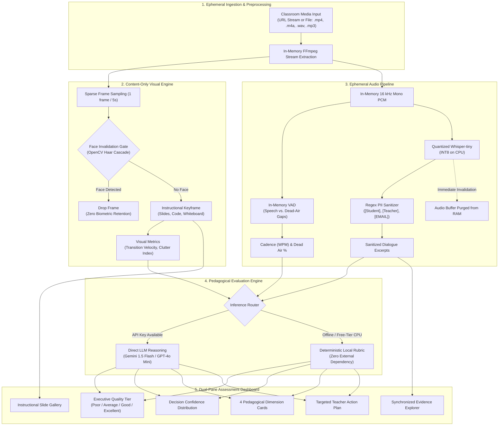

# 🎓 8x8 Class Quality Evaluator
### Privacy-First Multimodal Pedagogical Assessment Engine for Online Classrooms

[](https://www.python.org/downloads/)
[](https://streamlit.io/)
[](https://huggingface.co/spaces)
[](tests/run_all.py)
[](#-privacy-first-engineering--child-safety)

An AI-powered application built for the **Humaniti AI / 8x8 Class Quality Challenge** that ingests classroom recordings, evaluates pedagogical quality into **Poor, Average, Good, or Excellent**, and provides specific, evidence-backed observations and teacher coaching recommendations.

---

## 📌 Executive Summary

What makes one online class better than another? While verbal transcripts capture curriculum coverage, true instructional excellence lives across multimodal dimensions: **conversational cadence, dialogue balance, unguided silence voids, and instructional visual anchoring**.

The **8x8 Class Quality Evaluator** marries objective acoustic and visual telemetry with pedagogical LLM reasoning:
* **Privacy via Frame & Audio Eviction:** Enforces zero biometric data storage. All webcam frames containing human faces are immediately invalidated and purged. Audio streams are processed strictly in-memory and evicted immediately following Voice Activity Detection (VAD) and transcription.
* **Objective Multimodal Telemetry:** Quantifies Talk-to-Listen ratio, speech pacing (WPM), dead-air silence percentage, inquiry density (questions/hr), and slide transition velocity.
* **4-Dimension Pedagogical Rubric:** Deconstructs instructional quality across *Instructional Clarity*, *Student Engagement*, *Pacing & Delivery*, and *Content & Visual Structure*.
* **Dual Inference Architecture:** Evaluates sessions using direct LLM reasoning (Gemini / GPT) with an embedded, deterministic local rubric fallback—ensuring 100% offline availability and zero external API dependencies on CPU infrastructure.

---

## 🏛️ Pipeline Architecture



---

## 🛡️ Privacy-First Engineering & Child Safety

Online classes for children require strict compliance with data privacy principles. The application was designed from the ground up to prevent the persistent storage or exposure of biometric or personal identifiers:

1. **Face Invalidation Gate (Zero Biometric Retention):**
   * Video frames are sampled sparsely (1 frame every 3–5 seconds).
   * Every sampled frame is scanned using an OpenCV frontal face detector. Any frame containing a human face (instructor webcam, student faces) is **immediately discarded**.
   * Only instructional content (presentation slides, digital whiteboards, code editors) is retained for visual pacing analysis.
2. **Ephemeral In-Memory Audio Eviction:**
   * Audio streams are decoded into 16 kHz Mono PCM strictly in RAM.
   * As soon as VAD silence analysis and Whisper transcription complete, raw audio buffers are purged and garbage-collected (`EphemeralAudioBuffer` context manager).
   * No raw audio recordings are written to disk or sent to external media storage.
3. **Regex Transcript PII Sanitization:**
   * Transcripts undergo deterministic redaction prior to LLM evaluation or UI rendering:
   * Replaces student names with `[Student]`, instructor honorifics with `[Teacher]`, and scrubs emails, phone numbers, student/roll IDs, and external URLs.

---

## 📊 Measured Pedagogical Telemetry

| Telemetry Signal | Method | Optimal Pedagogical Benchmark | Diagnostic Impact |
| :--- | :--- | :--- | :--- |
| **Talk-to-Listen Ratio** | Turn-taking vocative analysis | 30% – 50% student share | Distinguishes engaging classrooms from disengaged teacher monologues. |
| **Speech Cadence (WPM)** | Word count over active speech | 125 – 160 WPM | Rates < 110 WPM indicate sluggish delivery; > 165 WPM risk cognitive overload. |
| **Dead-Air Percentage** | In-memory 30ms RMS VAD | < 12% total session time | Identifies unguided dead-air voids (> 20%) that interrupt conversational flow. |
| **Inquiry Density** | Interrogative syntax parsing | $\ge$ 15 questions / hour | Quantifies frequency of formative understanding checks and student prompts. |
| **Slide Transition Velocity** | Structural dissimilarity | 0.2 – 1.2 minutes / slide | Gauges pacing stability; flags visual skimming (> 2/min) or static slides. |
| **Visual Clutter Index** | Canny edge density | < 0.35 (clean whitespace) | Differentiates clean instructional decks from visual clutter. |

---

## 🎯 Pedagogical Assessment Rubric

The system evaluates classes across **4 core dimensions** (scored 0–100), synthesizing a composite grade and calibrated probability distribution:

1. **Instructional Clarity (30% weight):** Articulation rate, cognitive pacing, and clarity of conceptual explanations.
2. **Student Engagement (30% weight):** Student voice share, question density, and active response checkpoints.
3. **Pacing & Delivery (25% weight):** Rolling WPM, pause control, and avoidance of unguided dead air.
4. **Content & Visual Structure (15% weight):** Slide progression pacing, visual aids (deck, whiteboard, code editor), and layout readability.

### Classification Tiers
* 🟢 **Excellent ($\ge 82$):** Highly interactive inquiry, optimal pacing (125–160 WPM), balanced dialogue ($\ge 30\%$ student talk), and structured slide progression.
* 🔵 **Good (68–81):** Solid curriculum delivery, clear articulation, moderate cohort participation, and governed dead air.
* 🟡 **Average (50–67):** Instructor monologue ($> 80\%$ teacher talk), infrequent checks for understanding, marginal pacing, or elevated silence.
* 🔴 **Poor ($< 50$):** Disorganized delivery, excessive dead air ($> 22\%$), off-tempo cadence ($> 170$ or $< 110$ WPM), and passive cohort participation ($< 15\%$).

---

## 🚀 Quickstart & Local Setup

### 1. Prerequisites
* **Python 3.10+**
* **FFmpeg** installed on your system:
  * **macOS:** `brew install ffmpeg`
  * **Ubuntu/Debian:** `sudo apt-get install -y ffmpeg`
  * **Windows:** `choco install ffmpeg`

### 2. Clone Repository & Setup Virtual Environment
```bash
# Clone the repository
git clone https://github.com/your-username/8x8-class-quality-evaluator.git
cd 8x8-class-quality-evaluator

# Create and activate virtual environment
python3 -m venv .venv
source .venv/bin/activate  # On Windows: .venv\Scripts\activate

# Install dependencies
pip install -r requirements.txt
```

### 3. Run the Streamlit Application
```bash
streamlit run app.py
```
The dashboard opens automatically in your browser at `http://localhost:8501`.

### 4. (Optional) Configure External LLM APIs
The application runs **100% locally with zero external API keys** using its built-in deterministic pedagogical rubric engine. To optionally enable direct LLM reasoning via cloud models, export either:
```bash
export GEMINI_API_KEY="your-gemini-api-key"
# or
export OPENAI_API_KEY="your-openai-api-key"
```

---

## 🧪 Verification & Automated Testing

The repository includes a comprehensive 22-test suite covering UI scenarios, in-memory audio extraction, face-dropping filters, VAD dead-air detection, PII sanitization, and rubric scoring:

```bash
# Run the complete test suite
python tests/run_all.py
```

```text
============================================================
🚀 Running 8x8 Class Quality Evaluator Test Suites
============================================================
▶ Epic 1: UI & Telemetry Generator ............. [2 passed]
▶ Epic 2: Media Ingestion & Ephemeral Lifecycle . [6 passed]
▶ Epic 3: Face-Filtered Visual Content Engine ... [4 passed]
▶ Epic 4: Audio Telemetry, VAD & PII Sanitizer .. [5 passed]
▶ Epic 5: Pedagogical Evaluation & LLM Engine ... [5 passed]
============================================================
🎉 Results: 22/22 tests passed successfully!
============================================================
```

---

## 📂 Repository Structure

```text
├── app.py                     # Streamlit application entrypoint & state orchestrator
├── packages.txt               # OS-level dependencies for Hugging Face Spaces (ffmpeg)
├── requirements.txt           # Python dependencies (Streamlit, OpenCV, faster-whisper, Plotly)
├── README.md                  # Comprehensive architectural and setup documentation
├── src/
│   ├── ui/                    # Dual-pane UI layout and custom CSS styling
│   │   ├── layout.py          # Dual-pane orchestrator (Left: Evidence, Right: Assessment)
│   │   ├── styles.py          # Design system & CSS tokens
│   │   └── components/
│   │       ├── badge.py       # Executive quality tier badge and diagnostic headline
│   │       ├── kpi_cards.py   # Objective telemetry KPI cards with benchmarks
│   │       ├── charts.py      # Plotly decision confidence & SHAP impact charts
│   │       ├── pedagogical_dimensions.py # Sub-score breakdowns & coaching plan
│   │       └── transcript_viewer.py      # Media ingestion, slide tabs, & transcript explorer
│   ├── ingestion/             # Ephemeral media ingestion & FFmpeg normalization
│   │   ├── media_loader.py    # URL stream and local file upload reader
│   │   ├── audio_extractor.py # FFmpeg in-memory audio downmix to 16 kHz Mono PCM
│   │   ├── lifecycle.py       # Ephemeral audio buffer guard & memory eviction handler
│   │   └── models.py          # IngestedMedia data model
│   ├── vision/                # Face-filtered visual content engine
│   │   ├── face_filter.py     # OpenCV Haar face invalidation gate (0 biometric storage)
│   │   ├── frame_sampler.py   # Sparse frame extraction (1 frame / 5s)
│   │   ├── slide_analyzer.py  # Slide change detection, clutter index, & classification
│   │   └── pipeline.py        # Complete visual telemetry orchestrator
│   ├── audio/                 # Ephemeral speech transcription & telemetry
│   │   ├── transcriber.py     # Quantized Whisper-tiny (INT8 CPU) speech-to-text
│   │   ├── vad.py             # In-memory RMS VAD & dead-air quantification
│   │   ├── metrics.py         # Rolling WPM, question density, & talk-ratio extractor
│   │   ├── sanitizer.py       # Regex transcript PII scrubber (Option A)
│   │   └── pipeline.py        # Complete audio telemetry orchestrator
│   ├── models/                # Pedagogical evaluation engine
│   │   ├── schema.py          # Typed Pydantic/dataclass evaluation schema
│   │   ├── prompt_builder.py  # Structured LLM rubric prompt builder
│   │   ├── llm_judge.py       # Dual LLM (Gemini/GPT) + Local Rubric Engine fallback
│   │   └── evaluator.py       # Top-level evaluation session orchestrator
│   └── mock/                  # Interactive reference telemetry scenarios
│       └── telemetry_generator.py # Pre-computed sessions for interactive demonstration
└── tests/                     # Comprehensive test suites
    ├── run_all.py             # Unified test suite runner
    ├── test_mock_and_ui.py    # UI scenarios & Plotly tests
    ├── test_ingestion.py      # FFmpeg in-memory extraction & eviction tests
    ├── test_vision.py         # Face-filtering & clutter calculation tests
    ├── test_audio.py          # VAD, speech pacing, & PII sanitization tests
    └── test_models.py         # Rubric evaluation & prompt builder tests
```

---

## ☁️ Deployment on Hugging Face Spaces

This application is ready for 1-click deployment on **Hugging Face Spaces** using the Streamlit SDK:

1. Create a new Space on [Hugging Face](https://huggingface.co/new-space).
2. Select **Streamlit** as the Space SDK.
3. Push this repository to your Space repository:
   * `packages.txt` automatically instructs the container to install `ffmpeg`.
   * `requirements.txt` installs lightweight, CPU-compatible dependencies.
   * Quantized Whisper-tiny and OpenCV run comfortably within free-tier 2 CPU / 16 GB RAM quotas.
4. *(Optional)* Add `GEMINI_API_KEY` or `OPENAI_API_KEY` to your Space **Repository Secrets** if LLM cloud inference is desired.

---

## ⚖️ Ethical & Data Handling Statement

All media processed through this application is handled in strict compliance with the **Humaniti AI Challenge Ground Rules**:
* **Confidentiality:** Recordings are never persisted to disk, uploaded to public clouds, or shared across sessions.
* **Child Biometric Protection:** All sampled webcam frames containing human faces are immediately invalidated and discarded. Audio buffers are evicted from RAM post-transcription.
* **Zero Retention:** Evaluations operate ephemerally in-memory, leaving zero residual footprint.
